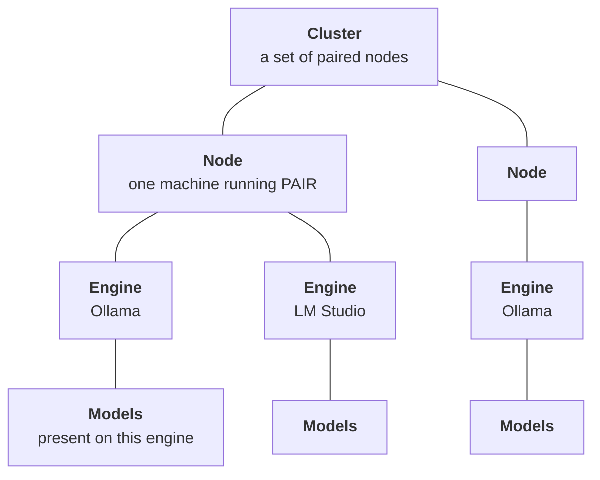
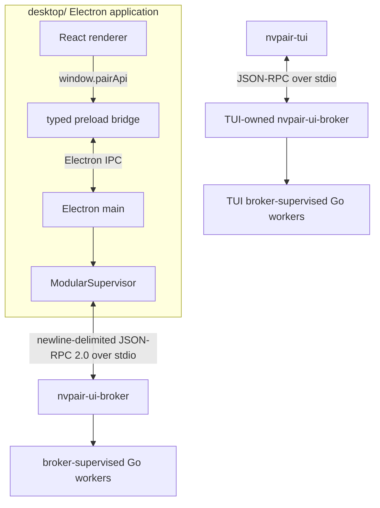
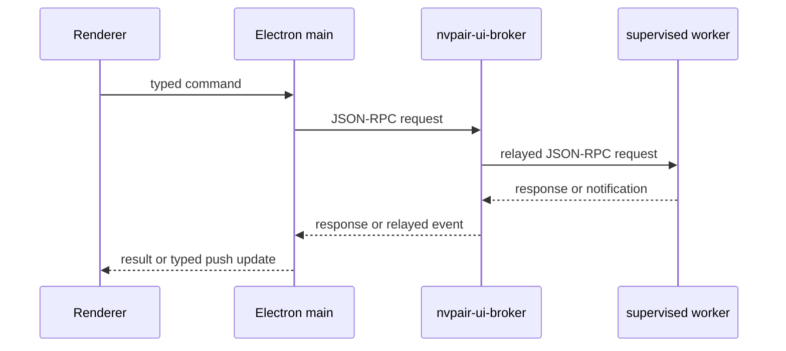
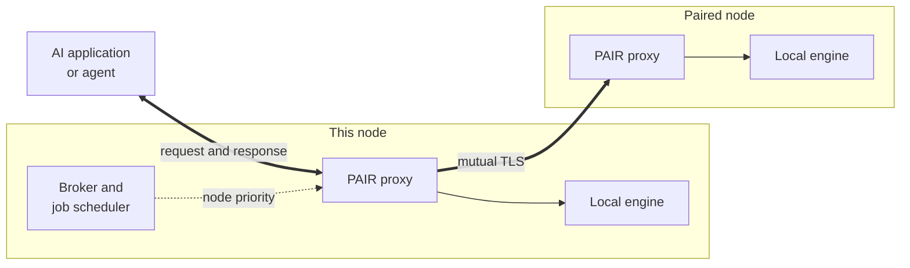
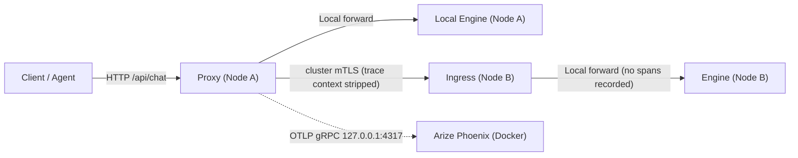
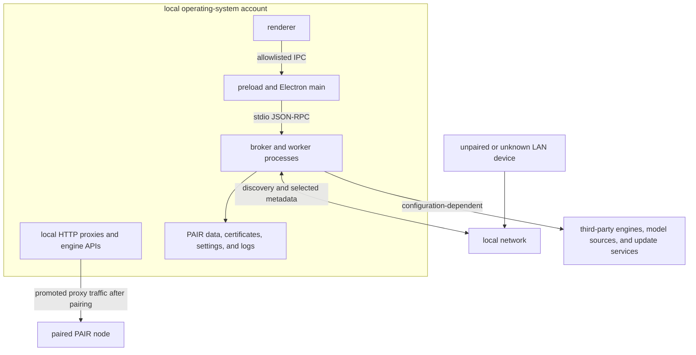

{/*
SPDX-FileCopyrightText: Copyright (c) 2026 NVIDIA CORPORATION & AFFILIATES. All rights reserved.
SPDX-License-Identifier: Apache-2.0
*/}

# NVIDIA Personal AI Router Architecture

Personal AI Router (PAIR) is a desktop-or-headless control plane around local Go
services and HTTP inference proxies. Its control traffic and inference traffic
follow separate paths.

## Cluster Shape

A cluster has four levels and a different component owns each one:

- A **cluster** is a set of nodes that have paired with each other. There is no
  founder, no primary, and membership is symmetric. A node belongs to at most
  one cluster.
- A **node** is one machine. Nodes are peers where each runs the same services, and
  each can both serve requests and route them elsewhere.
- An **engine** is an inference server on a node: Ollama, LM Studio, or oMLX.
  A node can run any supported combination or none; a node with no running
  engine is not eligible to serve. The bundled oMLX manifest supports macOS
  arm64 only and does not provide model pull/delete actions.
- **Models** belong to an engine on a specific node. Nothing is shared. The same
  model on two nodes is two independent copies and that duplication is what makes
  the two nodes interchangeable for a request.

PAIR evaluates eligibility at the bottom of that hierarchy. A request names a
model, so it can only be served by a node whose running engine holds it. Cluster
membership makes a node reachable. It does not make it capable.

## Process Architecture

Electron starts only `nvpair-ui-broker` as a Go service. The service inventory
contains 14 executables: broker + 12 workers (including `omlx-proxy`) + TUI.
The broker attempts to start available workers, probes their control health,
reports lifecycle state, and retries crashes, optional initial spawn failures,
and eligible hangs within a shared budget. Workers log to stderr; stdout is
reserved for newline-delimited JSON-RPC in stdio mode.

Standalone, only the scanner is required. Missing default auxiliary binaries or
initial auxiliary spawn failures are non-fatal, but invalid explicit paths are
fatal. Scanner initial spawn failure is fatal too. Missing defaults stay `missing`
without automatic retries until `workers:restart` finds them. Desktop additionally
prevalidates broker, scanner, Ollama proxy, node-info, and node-settings binaries.
`app:ready` does not establish that all optional HTTP listeners are ready; use
their reported status.

The terminal interface is a separate broker client for headless use, and is what
the `nvpair` command on PATH resolves to. Do not run it and the desktop
application on the same machine at the same time, because each starts its own
broker and worker tree and the two would then contend for the same local ports,
engines, and persisted settings.

### Health and Failure Detection

Worker health is a stdio JSON-RPC method, not an HTTP `/health` endpoint.
The checks have separate meanings at each layer:

| Layer | How it is checked |
| --- | --- |
| Engines | A readiness probe on start, then a periodic health probe. Status carries a `healthy` flag, and a failed probe raises a service error. |
| Workers | Process exit detection plus `worker/health` control-loop probes. Failed probes degrade state; eligible workers restart on a hang within a bounded budget. This does not prove domain progress or HTTP/inference readiness. |
| The broker | `ping` plus a 15-second notification heartbeat. Desktop detects 45 seconds of inbound silence and owns bounded stop/start recovery and rehydration. This does not monitor worker hangs. |
| Peer nodes | Reachability, not health: missed announcements, then recent inference activity, recent telemetry, or a probe of the node-info or engine-manager port before eviction. Peer inference proxies report activity; their HTTP listeners are not probed for peer reachability. |

Each of the twelve workers answers `worker/health` with `{"ok":true}`. The broker
probes every **30 seconds**, with a **5-second deadline**. The diagnostic flag
`--worker-health-interval` defaults to `30s` and requires at least `1s`; the
probe deadline is capped at the interval. **Two consecutive failed probes**
report `degraded`. Any successful probe clears the failure count and restores
`running`. After **three consecutive failures**, only these eight workers are
stopped through bounded escalation and restarted:

- `scanner`, `errors`, `settings`, `node-info`
- `workload-manager`, `manual-nodes`, `cluster-manager`, `scheduler`

**Engine-manager and all three proxies are never auto-restarted on a hang.**
Engine-manager restart can orphan engines; proxy HTTP inference runs separately
from stdio control, and restart would interrupt live streams. They still accept
explicit restarts. Their desktop rows show "Not responding — restart manually".
A successful probe can restore them without restarting.

Optional initial spawn failures, unexpected exits, and eligible hang restarts
share one budget: **1, 2, 4, 8, then 16 seconds** of backoff, with **five
replacement attempts per unhealthy streak** (in addition to the initial spawn).
Healthy reset requires both **60 seconds uptime and at least one successful
probe since that spawn**. A crash raises a sticky error; eligible hang restarts
report `subprocess <name> stopped responding`. Proven recovery clears the error;
exhaustion leaves the worker down until an explicit retry. `nvpair-errors`
cannot report its own death into itself, so its crashes go to stderr instead.

The broker registry is independent of the errors service. `workers:get-status`
returns all twelve workers with `running`, `degraded`, `restarting`, `exhausted`,
or `missing` state. Unconditional `workers:update` notifications carry full
snapshots, not deltas. `workers:restart {name}` initiates restart/retry, including
from exhaustion; a missing default is rechecked and only starts if found.
Desktop **Settings → Service → Workers** renders state, PID, attempts and last
error; engine-manager and proxy restarts require confirmation. TUI **Overview**
shows all twelve workers and uses **`R`** with confirmation. Both clients recover
worker snapshots on epoch changes; neither owns health/retry policy.

Cross-process hang tests are **Unix-only**; Windows hang recovery remains
unproven. These probes detect control responsiveness, not stalled domain
operations that continue to answer health requests.

Broker-channel silence is handled separately by the frontend. Desktop allows an
automatic recovery attempt after 45 seconds of inbound silence, waits for
readiness, and refreshes state; an unexpected broker exit still takes the crash
path. The broker's 15-second heartbeat is not a worker-health signal. Do not
infer unconditional crash reconnect from the silence-recovery mechanism.

## Control Flow

PAIR uses commands down and events up:

The renderer calls `window.pairApi` and preload carries those calls through
Electron inter-process communication (IPC). Electron main translates the stable
renderer contract to the broker's JSON-RPC methods. Backend notifications update
main-process state and produce typed renderer push events.

This entire path is local. The broker relays to workers on the same machine over
stdio and it is not a cluster transport. Facts about other nodes arrive through
the peer services described next, then surface as notifications on this path.

The JSON-RPC 2.0 transport uses **relay protocol v2**. Every notification carries
an `epoch` (sender process UUID) and `seq` (per-connection counter) envelope;
requests and responses carry neither. `broker:resync` returns the epoch and
`protocol: 2`, and `broker:epoch` announces them. Both Go codecs and desktop
TypeScript enforce this canonical envelope structure and treat envelope mismatches
as terminal rather than negotiating an older protocol. Reserved members (`jsonrpc`,
`id`, `method`, `params`, `result`, `error`, `epoch`, `seq`) must not appear with
duplicate keys or case variants; such framing violations are recoverable decode
errors, tested against the shared corpus
`services/shared/jsonrpc/testdata/envelope-conformance.jsonl`.

Desktop decodes `seq` losslessly as `bigint` (avoiding IEEE-754 precision loss
past 2^53 - 1) and drops malformed frames without resetting the 45-second silence
deadline. On an envelope protocol mismatch (missing or wrong-typed stamps on a
notification, or stamps present on a request or response), desktop terminates the
broker session cleanly, fails all pending calls, reports a crash with
`{ protocolMismatch: true }`, and does not reconnect. The legacy `broker:epoch`
params fallback has been removed completely. `seq` starts afresh per connection;
sequence gaps or regressions do not trigger snapshot polling.

On an epoch change, desktop rehydrates per-domain snapshots: discovery,
membership/identity, engines and models, errors, workloads, proxy status, and
telemetry status. Recovery is owned by the active connection/epoch so late
results from an old lifetime cannot replace current state. The broker's
15-second heartbeat and desktop's 45-second inbound-silence deadline provide
channel liveness, not individual-worker health.

## Node-to-Node Communication

Nodes do not talk to each other over the JSON-RPC control path. Each node runs the
same set of HTTP services, and peers call those services directly. There is no
central broker for the cluster. Every node is both a client and a server.

### Transport and Authentication

Most peer traffic runs over *mutual Transport Layer Security (TLS)*. Each node
holds a stable universally unique identifier (UUID) and a self-signed leaf
certificate, and pairing pins each side's certificate against the other's UUID. A
cluster-gated endpoint verifies that its caller presents a certificate pinned for
a current member and refuses anything else, so a machine that can reach the port
but has not been paired cannot read model inventory, read workloads, or drive a
remote engine.

Certificates and pinning are owned by `nvpair-cluster-manager`. Refer to
[SECURITY.md](../SECURITY.md) for the trust model and its limits.

Not every surface is gated, and the exceptions are deliberate:

| Surface | Transport |
| --- | --- |
| Proxy, local clients | Plaintext HTTP, loopback only |
| Proxy, cluster ingress | Mutual TLS |
| Model inventory, remote engine control | Mutual TLS |
| Workload replication, error synchronization | Mutual TLS |
| Cluster membership | Mutual TLS, after pairing |
| Pairing itself | Plaintext, authenticated by the PIN |
| Host and GPU telemetry | Plaintext HTTP, **not** authenticated |

Pairing is plaintext because no trust exists yet at that point. The six-digit PIN
is what authenticates the exchange that establishes the pinned certificates.

Node telemetry is a considered trade-off, not an oversight. It is treated as the
lowest-sensitivity inter-node surface and is read by consumers that are not
cluster members, so it stays plaintext even on a clustered node. The practical
consequence is that hostname, hardware inventory, and utilization for a node
running PAIR are readable by anything on the same subnet that asks. Do not run
PAIR on a network where that is unacceptable.

### Two Personalities on One Port

The proxies and `nvpair-cluster-manager` serve two different things on a single
port, chosen by the connection's first byte. A TLS handshake record starts with
`0x16`, and no HTTP method does:

| First Byte | Personality | Who Uses It |
| --- | --- | --- |
| Not `0x16`, proxy | Plaintext HTTP; substantive requests are loopback-only | Local applications; a non-loopback `OPTIONS` preflight may receive `204`, but grants no inference access |
| Not `0x16`, cluster manager | Plaintext pairing bootstrap, allowed from the LAN | Nodes establishing trust with a PIN |
| `0x16` | Mutual TLS | Paired nodes in the cluster |

This is why an endpoint is `http://127.0.0.1:11434` for an application on the
machine itself while the same port serves authenticated TLS to the network. Local
clients need no certificates, and routed inference between nodes is never
plaintext.

The proxy's loopback restriction is enforced, not merely conventional. Its
listener binds all interfaces so the TLS personality can accept peers, but a
substantive plaintext request from a non-loopback address is refused with `403`.
A preflight may receive `204` before that gate; it does not authorize the request
that follows. The cluster manager is different: its LAN-accessible plaintext
pairing bootstrap must work before a peer holds a certificate.

Two consequences follow, and together they define how clients are expected to
reach PAIR:

- **A machine that is not a node has no way in.** It cannot use the plaintext
  personality, because it is not loopback, and it cannot use the TLS personality,
  because it holds no pinned cluster certificate. Pointing an application at
  another machine's proxy port does not work by design.
- **A peer request is served, not re-routed.** The mTLS ingress forwards straight
  to that node's own engine and never re-enters candidate selection, so a peer
  cannot chain a request onward through a third node.

The second point is why the routing decision belongs to the machine the request
originates on. To give a workstation the whole cluster, make it a node. After it is a node, its local
proxy then routes on its behalf, whether or not it runs an engine itself.

### What Peers Exchange

Beyond routed inference, the peer services replicate the state the interface
shows:

- Host and GPU telemetry
- Per-node model inventory, so the proxy can judge a node eligible for a request
- Workload events, so every node can show jobs running anywhere in the cluster
- Service errors, so a failure on one node is visible from another
- Cluster-scoped engine control, for operating a remote node's engine

Each of these listens on its own port. Refer to the [port map](#port-map) below.

Electron polls every discovered node's `/v1/node-info` directly because that
detail is richer than the broker's control surface exposes. Healthy-node polling
runs every two seconds with a visible UI, or every 30 seconds when all windows
are hidden/minimized; failures use capped backoff. This is the one place Electron
makes service-data HTTP calls of its own.

GPU memory classification is owned by Go. Each adapter carries `memory_kind`
(`dedicated`, `unified`, `shared`, or `unavailable`); `vram_bytes` means capacity
of that kind, not necessarily dedicated VRAM. Apple macOS GPUs report unified
physical RAM with GPU-mapped allocation usage. Non-Apple macOS Intel GPUs report
a shared budget from `VRAM,totalMB`; other non-Apple GPUs (AMD/NVIDIA discrete)
report dedicated VRAM. Both use only dedicated-used counters, never system
allocation, for usage. Linux NVIDIA numeric totals mean dedicated VRAM;
`[N/A]` / `Not Supported` totals mean unified physical RAM with **system-used RAM**,
not GPU-only allocation usage. Malformed totals and names-only inventories report
unavailable memory; Linux AMD/Intel remain names-only without GPU utilization.
Windows DXGI adapters with dedicated video memory report it separately from
`shared_bytes` / `shared_used_bytes`; zero-dedicated adapters use the shared budget
as their primary memory. Windows runtime remains untested on the macOS
verification host. See the full
[wire contract and classification table](../services/nvpair-node-info/README.md#gpu-wire-contract).

Unknown GPU numbers are omitted on the wire; measured zero is present. Presence
is independent per adapter and metric. Desktop preserves unknowns as null, shows
`—`, and breaks history plots at gaps. It renders Go's kind as `VRAM`, `Unified
memory`, `Shared memory`, or `Memory unavailable`, without inferring from names.
Older peers without a kind render unavailable memory. Memory capacities and usages
are never summed across adapters or combined between dedicated and shared pools:
several adapters may refer to the same physical RAM. These fields do not change
routing: utilization pressure uses the maximum measured adapter utilization,
and invalid/stale telemetry retains neutral pressure, not a capacity estimate.

Local hardware GPU and CPU telemetry is lease-driven via `X-NVPAIR-Poll` request
headers:
- `foreground` (visible UI or local active workload) renews the interactive lease,
  sampling every 2 seconds.
- `scheduling` renews the scheduling lease, sampling every 5 seconds. The broker
  reports this intent via `telemetry/set-scheduling-demand`; the discovery scanner
  and manual-node telemetry use it only while that demand is active and poll as
  `background` otherwise. Both workers default to inactive on start, so an idle
  fleet renews no scheduling lease.
- `background` (minimized UI or internal queries) peeks the latest cached snapshot
  without waking the hardware collector or renewing any lease.
- When no lease is active and no active local workloads exist, sampling relaxes to
  an idle cadence of 10 seconds on macOS and Linux. Windows remains on its native
  1-second PDH collector loop.

The broker coordinates local demand by pushing `stats/set-demand` notifications
with `localExecution: bool` to `nvpair-node-info` over stdin whenever local
workloads are queued, active, or complete. Separately, it pushes
`telemetry/set-scheduling-demand` with `active: bool` to `nvpair-node-scanner`
and `nvpair-manual-nodes` whenever the fleet-wide demand changes: true on the
first non-terminal workload in its store (queued or running, local or
peer-origin) and false when the last one finishes or is removed. Both workers
start inactive and are re-told the current value on every (re)spawn. Because they
poll on a fixed cadence, a transition can leave at most one poll interval where
an active fleet still peeks; the next poll renews the lease and the scheduler
treats that gap like any other stale sample, never as fresher than it is. A
1-second collection timeout bounds sampling latency. At the scheduler's decision
point, sample age across all lease transitions is mathematically and empirically
proven <= 8.5 seconds, strictly within the scheduler's 10-second freshness
budget. Each sample carries a monotonic `sampleSeq` counter; repeated
observations carrying an identical sequence number do not re-weight the
scheduler's EWMA.

Separately, `nvpair-manual-nodes` delivers compact scheduling telemetry via
`node/telemetry` notifications every ~2 seconds (± 250 ms jitter) over persistent
HTTP connections with honest age accounting (including network probe latency and
collection age), decoupled from the slower 10-second node topology and model probes.
The broker relays telemetry straight to the job scheduler; routing never depends
on renderer metrics.

## Inference Data Flow

Inference HTTP does not travel through the renderer-to-broker JSON-RPC path.

Responses stream back along the same path they arrived on. One request goes to one
node and the proxy never splits it.

Engines started by PAIR bind to loopback, so a peer never reaches another node's
engine directly. It goes through that node's proxy, which is the only
cluster-facing entry point.

### How a Node Is Chosen

The proxy owns the per-request decision, and it does not produce a single winner.
It produces an **ordered failover list** of nodes eligible for that request, then
walks it.

For model-bearing inference, eligibility is a hard gate: the proxy takes a
request-local copy of the latest discovery snapshot and keeps only nodes whose
per-engine inventory advertises the requested model. Within that owner set, or
across all candidates when the request has no parsed model, the order is:

1. **A manually selected node**, if one is pinned.
2. **A recent prefix-cache hint**, when the eligible node has at most one pending
   job plus optimistic reservations and GPU pressure below three.
3. **The scheduler's priority order**, when no usable affinity hint applies.
4. **Remaining nodes by stable node ID**, so cold start and unlisted nodes are
   predictable rather than random.

Prefix-cache hints are passive and local to each proxy process. Successful HTTP
200 responses that reach clean EOF register only request digests and node metadata
in a bounded LRU table (10,000 entries, five-minute idle expiry). Follow-up chat
requests match the longest previously served message prefix, including across
assistant replies. No response text is retained, and the hint does not prove
that an engine still holds the KV cache. See [Prefix-aware routing](prefix-aware-routing-spec.mdx).

Manual selection is a proxy capability rather than a desktop feature. The desktop
application never pins a node. It renders routing state and lets the scheduler
decide. The only way to pin one today is the terminal interface's **Proxies** tab,
which selects a node with `enter` and returns to automatic with `a`. Treat
automatic routing as the normal case.

<Note>
A pin cannot override model eligibility. If the pinned node does not advertise
the requested model, automatic ordering continues among the advertised owners.
</Note>

This is why the broker and the scheduler appear in the diagram. Neither touches
the request, and their only job is to keep the proxy's preference order current.
`nvpair-job-scheduler` holds no socket and never talks to another node, so an
ordering reaches a proxy in three steps:

1. The broker feeds the scheduler every workload transition it accepts, locally
   or from a peer, plus compact GPU telemetry from discovery.
2. The scheduler ranks the nodes and hands the ordering back.
3. The broker relays that ordering to each proxy.

The ranking combines *pending work and GPU pressure*. A workload counts as
pending while it is queued or running, and it is attributed to the node it was
placed on. All three engines count together, so load from Ollama, LM Studio, or
oMLX affects the same node-wide ranking.

GPU pressure is deliberately coarse. The scheduler smooths the busiest GPU's
utilization, maps it to 0–3 pressure units at 40%, 70%, and 85%, and uses lower
thresholds on the way down to avoid rank thrash. Missing, invalid, or
older-than-ten-second telemetry contributes a neutral pressure of 1. Nodes sort
by pending plus pressure, then by pressure, then by node ID, which makes cold
start deterministic. Rankings recompute when a meaningful input changes,
reconcile on a one-second timer, and are only published when the order, the
counts, or the pressure changed.

Ranking cannot close one gap on its own. A node's pending count only rises after
its workload report arrives, so requests dispatched at the same moment would all
see the same idle node and pile onto it. To prevent that, each proxy adds the
requests it has just dispatched itself to its own estimate and reserves its
choice before forwarding, so a burst spreads without waiting for those reports.

### Models Do Not Need to Be on Every Node

**You do not have to put the same models on every node.** A cluster where one
machine holds a large model and another holds a small one is a supported and
sensible configuration. The proxy matches each request to the nodes that can
serve it.

The important thing to understand is that the scheduler and the model matching are
two different mechanisms, and they compose in one direction:

- **The scheduler is model-blind.** It ranks every node by pending work and GPU
  pressure. It does not know which models exist where, and its ordering never
  mentions a model.
- **The proxy enforces model capability.** It removes nodes that do not advertise
  the requested model, then applies the scheduler's ordering to the remaining
  owners.

So load balancing happens **among the nodes that can serve the request**, not
across the cluster as a whole.

#### Capability Gate

When an inference request contains a non-empty model, only nodes whose current
inventory for that engine advertises the model enter the failover list. An empty
inventory and an inventory that lists other models are both ineligible. Ollama's
implicit `:latest` tag is normalized; LM Studio model IDs match exactly.

If no advertised owner is routable, the proxy returns an actionable local `502`
without sending the request to an engine. It does not broaden the candidate list
or refresh inventory synchronously; a later discovery update makes a newly
advertised owner eligible.

A request whose model cannot be parsed keeps the ordinary non-model ordering.

Model listings are not routed at all. A `GET` of `/v1/models` or `/api/tags` is
fanned out to every candidate concurrently and the replies are merged, which is
why the answer is the cluster's inventory rather than one node's.

#### Failover and Inventory Freshness

An advertised owner's inventory can still become stale after candidate
selection. If that owner answers inference with `404`, the proxy treats it as
retryable and moves to the next advertised owner. It never fails over to an
unknown or known-missing node. Genuine client errors such as `400` or `422` are
not retried, because they would fail identically everywhere.

#### Planning Model Placement

Where you put each model decides what routing can do with it:

- **One copy of a model means no balancing for it.** Every request naming it goes
  to the node advertising it, however loaded that node is, because no peer can
  be substituted.
- **Preparing a model on more nodes is what gives the scheduler room.** With the
  same model advertised on three nodes, the scheduler's GPU-aware load order
  decides among them. This is the reason to duplicate a model, and the only
  thing that makes those nodes interchangeable.
- **Mixed inventories work.** Node A can hold a 70B model and node B a 7B one.
  Requests for each are steered to the node that has it, and neither blocks the
  other.
- **A model on a node with no running engine does not count.** Eligibility needs
  a running engine as well as the model. Refer to the earlier hierarchy.
- **Where work actually ran is observable.** Use the **Jobs** view rather than
  inferring routing from inventory.

### Scheduler Limitations

There is one policy today and it combines job count with coarse GPU utilization.
That is useful load feedback rather than a complete capacity model. These are the
known limitations, stated plainly so you can predict where routing falls short.

**It sees pressure, not capacity.** GPU model, available VRAM, and measured
latency are not inputs. The same utilization percentage maps to the same pressure
on a small and a large GPU, so a mixed cluster can still favor a slower machine.
Missing or stale telemetry is neutral rather than treated as idle.

**Multi-GPU nodes use the busiest device.** The compact telemetry feed reports
the maximum utilization across GPUs. That conservative choice avoids steering
more work to a node with one saturated device, but the scheduler does not know
which engine or model uses which GPU and can overlook idle capacity elsewhere on
the same node.

**Every workload counts as one.** A three-token completion and a long generation
are the same unit of pending work, so "fewest jobs" is not "least busy." A node
running one enormous request looks more idle than a node running two trivial ones.

**Model load state is not considered.** Eligibility asks whether a node *has* the
model, not whether it is already loaded in memory. PAIR knows which models are
loaded, and the interface shows it, but routing does not use it, so a request can
be sent to a node that must cold-load the model while a node holding it warm sits
one place lower in the order.

**Only work PAIR routed contributes to pending counts.** Inference sent straight
to an engine's own port is absent from workload events. GPU-heavy external work
can still raise pressure, but CPU-only work and queued demand remain invisible.

**All three engines are counted as one pool.** Ollama, LM Studio, and oMLX load
is summed, and maximum GPU pressure applies to the whole node. That is
conservative on a typical single-GPU machine and can underuse a multi-GPU node
where the engines occupy different devices.

**Every node ranks from its own view, and views lag.** There is no shared
schedule. Two nodes dispatching at the same moment can briefly steer work to the
same idle peer, because each sees an eventually consistent picture and a peer's
counts trail by relay latency. Per-proxy reservations cover the local burst case,
but they are local: one node cannot see what another just dispatched. The system
self-corrects through workload relay and periodic reconciliation rather than
preventing the collision.

**Unranked nodes fall back to identity order.** A node the scheduler has not
ranked yet is ordered by node ID, which has nothing to do with load. That happens
at cold start, or for a manual proxy target the scheduler's discovery never saw.
The fallback degrades ranking quality without causing a misroute. Missing
telemetry for a ranked node is different: that node takes the neutral pressure
value and stays in the normal ranking.

Improving this, and likely offering a choice of policies, is planned work. Which
of these gaps matters most depends on the hardware people actually run, so
reports from real deployments are more useful than guesses. Refer to
[Roadmap](../README.md#roadmap).

## Engines and Ports

`nvpair-engine-manager` owns everything about a local engine except serving
inference. It finds the engine, installs it, starts and stops it, and chooses the
port it listens on.

### Finding an Engine

PAIR does not assume it installed the engine. Detection checks the manifest's
known install locations for each engine, so an Ollama or LM Studio you installed
yourself is found where it already is. "Installing" an engine that is already
present downloads nothing and reports it as installed.

Starting is similarly deferential. If something is already serving the engine's
port, PAIR **adopts** that instance instead of spawning a second copy, and reports
it as running even though it did not start it.

Adoption is a real distinction, not a label. PAIR cannot stop or move a process
it did not start, so it refuses operations that need process ownership rather
than faking them. Changing the port of an adopted engine returns an error
instead of leaving two listeners on different ports. To get an instance PAIR can
fully manage, stop the engine in its own application and let PAIR start it on a
port nothing else is serving.

### Port Takeover

An application that already works with Ollama is configured for `11434`. If PAIR
listened somewhere else, every tool would need reconfiguring to gain anything, so
PAIR inverts it: the **proxy** takes the port the engine would normally use, and
the engine moves behind it — Ollama to `11435` and upwards, LM Studio to `1235`
and upwards. Existing clients keep working untouched and transparently gain the
cluster.

This is also what makes the engine unreachable from outside. Engines PAIR starts
bind to loopback, so the only network-facing listener is the proxy, which is where
cluster authentication lives.

An inherited `OLLAMA_HOST` naming a different local plaintext port is honored as
well. The broker gives the proxy that normalized loopback-only alias, reserved
against engine and proxy port plans so a relocating engine can never land on it.
`localhost` claims IPv4 and IPv6 together, and remote and HTTPS
targets are never intercepted. Clients already configured through the variable
therefore enter the same routing path without being reconfigured.

The rearrangement is conditional, and PAIR yields rather than fights:

- An **unknown process** is never moved or killed, whatever is holding the port.
- A running engine PAIR **adopted** is left alone when the only way to move it
  would be to kill its process. Ollama works this way. Where the engine publishes
  an official stop command, as LM Studio does with `lms server stop`, PAIR can use
  that command to stop it and bring it back on the configured port.
- If the engine is already running on the compatibility port, PAIR does not take
  that port. The proxy stays where it is and the takeover is reported as blocked.
- If anything else holds the port, the outcome is the same. PAIR steers the proxy
  to a free port and raises a warning rather than forcing a conflict.

The practical consequence is the one in
[Troubleshooting](troubleshooting.mdx#requests-work-but-pair-shows-no-jobs). Start
the Ollama desktop application and it takes `11434` for itself, so PAIR cannot,
and requests reach that local Ollama without ever being routed.

### Port Map

A default installation listens on these ports:

| Port | Listener |
| --- | --- |
| `11434` | Ollama-compatible proxy (Ollama itself moves to `11435`+) |
| `1234` | LM Studio OpenAI-compatible proxy (LM Studio moves to `1235`+) |
| `1236`+ | oMLX proxy fallback when `1234` is occupied/reserved by LM Studio; standalone oMLX proxy defaults to `1234` |
| `14318` | Node hardware, utilization, and identity telemetry (not model inventory) |
| `14319` | Service-error synchronization between nodes |
| `14320` | Workload propagation between nodes |
| `14321` | Pairing and cluster membership |
| `14322` | Model list served to cluster peers |
| `14323` | Cluster-scoped remote engine control |
| `4317` | Optional Phoenix OTLP gRPC collector, when its container is running |
| `6006` | Optional Phoenix web UI / OTLP HTTP, when its container is running |

The broker negotiates the oMLX fallback from `1236` upward, excluding reserved
ports including `1234` and `1235`. Consult reported proxy status for its actual
endpoint rather than assuming a fixed port. Phoenix's published ports are strictly
loopback-only (`127.0.0.1:6006` and `127.0.0.1:<collectorPort>`); see
[Observability](#observability-and-distributed-tracing).

The `143xx` listeners are the peer surfaces from
[Node-to-Node Communication](#node-to-node-communication). Their numbers are
fixed, so the broker can tell a worker which port to serve without a handshake.

The components that own proxy and engine ports persist them and restore them on
the next start, so a port a user chose survives a restart. Refer to
[Ports](getting-started.mdx#7-connecting-your-agents-and-port-information) for how
to change one.

## Discovery and Identity

`nvpair-node-scanner` is the single place a host advertises itself and the single
place it learns about the LAN. Other services register their ports with it rather
than advertising separately, and consumers subscribe to its directory rather than
browsing themselves.

### One Record for Each Node

The scanner advertises one `_nvpair-node._tcp` multicast DNS (mDNS) record for
each host, and that record carries two kinds of content:

- The ports its sibling services registered: node-info, all three proxies,
  errors, workloads, cluster manager, and engine manager
- The node's identity: `uuid=`, `cluster-uuid=` after clustering, and where to
  reach it — `ip=` for the address the node ranks first, and `ips=` for the whole
  ranked list

Publishing the list rather than one address is what lets a peer keep trying. A
machine can be reachable on one interface and not another, so a peer works
through the candidates instead of giving up on the first, and remembers the one
that answered.

One consolidated record instead of one for each service is a deliberate
constraint. mDNS TXT records are small, so per-service records would not hold the
payload. Bulky facts like the model list are fetched over HTTP afterwards instead
of being crammed into TXT.

### Node Identity

PAIR identifies every node by a stable UUID, never by its hostname.

An mDNS instance name defaults to the hostname, so two machines that share one
would silently merge into a single node. Every service therefore advertises a
per-host UUID, and the directory is keyed by it.

That UUID is the correlation key across the entire system: discovery entries,
cluster membership, workload attribution, error reports, telemetry, and proxy
routing all resolve against it. Hostnames are display only. A machine can be
renamed without becoming a different node, and a duplicated hostname does not
collapse two machines into one.

The UUID reuses the cluster manager's persisted identity when that exists, so one
host presents the same UUID everywhere. If the cluster manager has never run, the
scanner mints one and persists it.

### Sharing UDP 5353

PAIR runs its own mDNS responder rather than depending on a system one, because
Windows ships none. That responder must coexist with whatever else is on the
port, including Bonjour, Avahi, and PAIR's own sibling processes. It therefore
sets `SO_REUSEADDR` on the socket to share UDP 5353.

It deliberately does **not** set `SO_REUSEPORT`. On Linux that load-balances
incoming unicast datagrams across every socket sharing the port, which would let
one process swallow mDNS replies meant for another.

### Node Enrichment

Announcements establish that a node exists and which ports it serves. PAIR
fetches the interesting facts afterwards, for each node, over HTTP:

- GPU, CPU, and memory inventory from its node-info port
- Its model list from its engine-manager port, as a flat union, a per-engine
  breakdown, and the per-engine set of models currently loaded in memory

Each enrichment keeps a last-good value, so one failed fetch dims nothing. A
node's card does not blank out because a single poll timed out.

With a cluster directory configured, a browsed peer whose `cluster-uuid=` matches
a pin this node holds is annotated as trusted, which is how the interface can
distinguish a paired node from a stranger it can merely see.

### Node Eviction

The scanner scans every five seconds and tolerates three consecutive misses
before it treats a node as gone. Even then it does not drop the node right away.
It runs these checks and keeps the node if any of them answers:

- Inference the node served in the last minute, which the proxies report
- Recent telemetry from that node
- A direct request to the node's node-info endpoint
- A probe of the engine-manager port

The activity check comes first because a node under load is the one most likely
to miss an announcement, and evicting it would pull a working machine out of the
routing pool at its busiest.

The remaining checks deliberately avoid the inference proxy ports. Those ports
exist to serve requests, and using them as a liveness test would put connection
attempts on the serving path every time multicast dropped a packet.

Multicast is lossy, and Wi-Fi, VPN adapters, and sleeping network interfaces all
produce gaps that have nothing to do with a node's health. Without that probe a
momentary gap would evict a perfectly healthy node and take its models out of the
routing pool.

Discovery holds record replacement to the same standard. A node can reappear with
a new identity, for example after a reset. The old entry then looks superseded,
and leaving both in place would list the machine twice. But a matching address
and hostname arrive in an unauthenticated announcement that anything on the
network can send, so those signals only mark the old record as a suspect.
Discovery confirms the node's identity before dropping that record. A stale
duplicate therefore cannot linger, and nothing can displace a peer by claiming
its address.

### Manual Nodes

Some networks block or filter multicast, so discovery is not the only path in.
`nvpair-manual-nodes` takes an address you enter directly and probes it on a
fixed interval, and a manual node that answers is folded into the same directory
as a discovered one. It is initially keyed by the address you typed, and re-keyed
to the peer's real UUID as soon as that node reports it.

## Observability and Distributed Tracing

PAIR includes built-in OpenTelemetry (OTel) tracing and Arize Phoenix observability.
Every proxy (`ollama-proxy`, `lmstudio-proxy`, `omlx-proxy`) instruments local inference
requests, scheduler routing decisions, and engine dispatch operations.

### Local-Only Tracing Topology

Tracing is strictly local to each node. Exporters dial loopback only (`127.0.0.1:<collectorPort>`,
default 4317). Serving nodes record no spans for peer-originated requests, and W3C trace context
headers are stripped before forwarding so no trace context crosses node boundaries:

- **Managed Container:** The broker manages a local Phoenix container from an embedded
  Compose template (`project nvpair-telemetry`, container `nvpair-phoenix`), pinned to
  `arizephoenix/phoenix:version-20.23.0@sha256:c542e7de1dc1fdd0f938de337d44ebefa7266e91391eed6e7978523d7f6e1f2f`.
  Both web UI (`127.0.0.1:6006`) and OTLP gRPC (`127.0.0.1:<collectorPort>`) bind
  strictly to loopback.
- **Trace Context Stripping:** When a proxy forwards a request to an engine or cluster peer,
  it strips all W3C trace context headers (`traceparent`, `tracestate`). Ingress handlers on
  peer nodes do not extract trace context or record cluster ingress spans.
- **No Collector Advertisement:** Collectors are strictly local and are not advertised via
  mDNS or discovery records.
- **Batched Export & Delivery Health:** Tracer providers batch spans in memory. The broker
  polls proxy export delivery health (`lastExportOk`, `lastExportError`, `lastExportErrorAt`)
  via `telemetry/status` and reports health directly to clients.

### Settings Configuration & Dynamic Reconciliation

Proxy telemetry is configured exclusively through the broker:

- **Revisioned Settings (Schema 2):** Settings are stored in `settings.json` under
  `schema_version: 2` with monotonic `telemetry_revision` numbers. Proxies start with
  tracing disabled and do not inspect `PAIR_TELEMETRY_*` or `OTEL_*` environment variables.
- **Dynamic Broker Reconciliation:** When settings change (via `settings/set-telemetry-config`
  or loaded at startup), the broker reconciles desired state into each running proxy via
  serialized `telemetry/configure` requests. If the settings worker becomes unavailable,
  the broker retains the last loaded desired configuration so proxy restarts preserve the
  user's persisted choice.
- **Delivery and Apply Status:** `telemetry/get-status` reports desired configuration
  alongside per-proxy applied revisions, worker states (`applied`, `pending`, `failed`, or
  `unavailable`), and exporter health.

### Dual-Mode Payload Control & Privacy

Tracing operates under strict privacy and consent controls:

- **Explicit Informed Consent:** Content capture defaults to off and requires explicit user
  consent conforming to policy version 1 (`payload_consent_version: 1`). Migration from earlier
  settings resets tracing and capture to off and clears consent.
- **Header Allowlisting:** Only `Content-Type` and `Content-Length` request headers are
  captured as span attributes. All other custom or authentication headers are omitted entirely.
- **Payload Truncation:** When payload capture is explicitly consented, prompt and
  completion text are truncated to 16 KB UTF-8 (`pair.gen_ai.prompt.truncated`).
- **Trace Storage & Scoped Purge:** Phoenix stores traces in named Docker volume
  `nvpair-phoenix-data`. The broker measures volume sizes for status reporting and provides
  `telemetry/purge-storage` (requiring confirmation string `"delete-traces"`). Purge safely
  stops the managed Compose project, deletes only volumes labeled
  `com.docker.compose.volume=nvpair-phoenix-data`, and never force-removes containers or
  prunes unrelated Docker data.
- **Log Sinks Never Contain Secrets:** System log sinks (`slog`, `applog`, stderr, file logs)
  never record prompts, completions, PINs, or credentials.

### Inference Metrics

Alongside tracing, PAIR reports what each engine measured about an inference
request: the prefill and decode token counts, the prefill and decode
durations, the time to first token, and the cached-token count. The numbers
travel the workload lifecycle, are aggregated per node by each broker, and are
rendered by the desktop.

- **Engine-measured only:** The proxies read the phase values each engine
  reports in its own response `usage` block. PAIR never estimates a phase it
  cannot observe — no duration is derived from PAIR's own timings, and no
  value the engine did not report is filled in with a number PAIR measured
  itself. A value the engine did not report stays absent, and the desktop
  shows it as "not reported" rather than as a zero, so a missing phase and a
  measured zero never look alike. A value the engine *did* report as zero
  stays a zero: oMLX reports a cached-token count of zero on every request
  that missed its prefix cache.
- **Which engine reports what:** oMLX is the only engine that reports a
  cached-token count and a total duration (`usage.total_time`); Ollama
  reports token counts and the two phase durations; LM Studio reports token
  counts only. `totalMs` is therefore engine-reported only — for Ollama and
  LM Studio it stays absent, because the proxy's own wall-clock duration
  includes queueing, transport and client write time and would not mean the
  same thing. The desktop leaves the optional extras out entirely when the
  engine reported none: the Total row and the cached-token row are absent
  rather than zero, while the phase rows stay and say "not reported" — for a
  job that reported a partial measurement, the phase it did not report reads
  "not reported". A job that reported no measurement at all shows no
  measurement block: a failed job, or a job whose engine sent no usage block,
  has nothing to report and must not carry a block of "not reported" noise.
  The node card shows no cached-token row at all: the broker's node totals sum
  the cached counts but carry no counter for the requests that reported one,
  so a node-level total would read as a measured zero on a node whose engine
  never measured one. The cached count is shown per job, where the engine
  reported it.
- **Cluster-wide lifecycle:** The terminal `workload:completed` /
  `workload:errored` event carries the measurement on the workload object. The
  workload lifecycle stream already reaches every broker in the cluster, so the
  measurement travels with the job and is attributed to the node that served it
  (`scheduledOn`).
- **Per-node and per-model aggregation:** Each broker keeps a per-node
  accumulator (`nvpair-ui-broker/nodemetrics`) holding totals since the broker
  started, a 60-second rolling window used for the current rates, presence
  counters that say how many requests reported each value, and a per-model
  breakdown of the same totals. It is fed only from accepted workload merges,
  so a re-asserted terminal event or a synthesized node-loss failure cannot
  inflate the totals. The broker serves the snapshot over
  `metrics:get-node-metrics` and pushes it to subscribed clients as
  `metrics:node-metrics`, coalesced to at most one push per second. The push
  is measurement-driven, so a node's rate decays toward zero as its window
  empties without ever being pushed; the desktop therefore re-reads the
  snapshot on a short interval (every five seconds) so the rates it shows are
  the broker's current ones rather than the last pushed ones.
- **Desktop rendering:** The desktop shows the per-request measurement on the
  job card and the per-node figures on the node card, with the per-model
  breakdown behind a disclosure that is collapsed by default. Every figure is
  labelled with the window it covers, and the node's totals say that they
  cover the time since the broker started rather than reading as a lifetime.

### The Engine-Native View

An engine can report on itself. PAIR carries that report **beside** its own
numbers, never inside them.

- **Where it comes from:** The engine-manager serves `GET /v1/engine-stats`
  and `GET /v1/engine-activity` on its `em` surface — the same listener as
  `GET /v1/models`, behind the same two gates: plaintext for loopback only,
  cluster mTLS for pinned peers. The node-scanner fetches the stats from
  every peer over the mTLS pool it already uses for the model list, on its own
  slower cadence (a minute), and folds them onto the node record as
  `engineNative`. The broker copies the field onto its own node record, and
  the desktop shows it on the node card as a clearly separate "engine
  self-report" section.
- **PAIR's own type, not the engine's payload:** oMLX's admin stats payload
  carries the engine's own `api_key`, along with its host, port and CLI
  prefix. PAIR maps the fields it needs onto its own type field by field, and
  that type has no field for the key, so it cannot leak. oMLX is the only
  engine that publishes an admin API; for every other engine the view is
  absent, and an absent view is a normal state, never a zero.
- **Counters, speeds and models — no durations:** The view carries the
  engine's cumulative counters (requests, prompt, completion and cached
  tokens, cache efficiency), its **speeds** (average prefill and generation
  throughput) and the models it lists as active. It carries **no phase
  durations**: the engine's stats endpoint reports none, and the durations on
  the engine's usage endpoint are scoped to a date range rather than to the
  engine's life, so a day-scoped number would not belong beside the lifetime
  counters.
- **It is the engine's own account of its work,** so it includes traffic PAIR
  did not route. A client therefore shows it beside PAIR's numbers and never
  merges the two: adding them together would count overlapping work twice.
- **Freshness:** Every fetch is a new observation, so the view's `observedAt`
  stamp advances even when the counters do not move. A client computes
  staleness as `now - observedAt`, which is what tells a live but idle engine
  apart from one that stopped answering. A node whose fetch fails keeps the
  view it had — the last-good rule the model list follows too.

### Live In-Flight Progress

A running job can show what has arrived so far, without waiting for it to
finish.

- **What PAIR measures, exactly:** The proxies count the content chunks and
  the response bytes they received, and time the first response byte. A frame
  leaves at most once every two seconds per in-flight request **per proxy**,
  so a cluster with twenty running jobs carries at most ten frames per second
  on any one proxy, whatever the engines' chunk rates are. The bound is per
  proxy, not per cluster: a job served on a peer is measured on two nodes —
  the origin's proxy publishes what PAIR measured of the client's stream, and
  the serving node's proxy publishes what it measured of the engine's — so
  such a job can carry two frames per two-second window.
- **Publishers, one job id:** The origin proxy publishes the facts PAIR
  measured of the client's stream. A node that serves the job for a peer
  publishes what it measured of the engine's stream, and the oMLX proxy's
  poller publishes what the engine reported of its own request, under the same
  job id. The oMLX proxy's two publishers — the one driven by the response's
  chunks and the one driven by the engine's rows — share the job's one window,
  so the frame that leaves carries **both** halves of the view: the facts PAIR
  measured and the engine's own reading. A frame is a **partial** view across
  nodes: a field a frame does not carry means "not measured here", never
  "zero".
- **The origin travels with the request:** A request forwarded to a cluster
  peer carries the origin's job id, the origin's node id and the origin's run
  nonce. The serving node publishes its frame under that identity, so every
  member of the cluster keys the job's live view the same way and the job's
  terminal event — which names the origin — retires it.
- **How it travels:** The workload-manager broadcasts the frame to every
  pinned peer. Each broker keeps a bounded live view of the running jobs and
  pushes the merged view to its clients as `workloads:progress`. A frame
  never enters the workload catalog and never changes a job's state; a
  terminal event retires the job's live view, so a frame that arrives late
  cannot bring a finished job back to life.
- **The job's identity:** A live view is keyed by the origin node, the
  engine and PAIR's job id, the same identity the workload catalog uses
  (which adds the run id). PAIR's job id is a per-proxy counter, so two
  origins can both hold a job "1" — and every engine's proxy counts from 1
  as well, so an oMLX job "1" and an Ollama job "1" on one node are two
  different jobs. Only the origin and the engine together tell two jobs
  apart. The run id says which run a job id belongs to, so a proxy that
  restarted and counts from 1 again never inherits the old job's numbers.
- **What the desktop shows:** A running job shows the live line — the elapsed
  time and the chunks and bytes that arrived — plus the engine's own live
  reading when the engine reported one. A finished job shows the final exact
  numbers the engine reported, and the live line goes away with it.

### No Estimates

Nothing on these surfaces is estimated, interpolated, or derived from a
different quantity.

- A **chunk count is never presented as a token count.** PAIR does not know
  the engine's token count until the response ends, and a chunk is not a
  token. The live line shows the chunks and the bytes as what they are.
- The **engine's numbers are never replaced by PAIR's own.** `totalMs` is the
  engine's `usage.total_time` and nothing else: a proxy-measured wall-clock
  duration covers queueing, transport and client write time and would not
  mean the same thing.
- A **value nobody reported stays absent.** A phase the engine did not
  measure, a reading a frame did not carry, a node with no engine-native
  view — all are absent, and the desktop shows "not reported" or omits the
  row entirely. A **measured zero stays a zero**: oMLX reports a cached-token
  count of zero on every request that missed its prefix cache, and that zero
  is shown as a zero.
- The **engine-native counters and PAIR's own numbers are never added
  together.** They count overlapping work.

## Trust Boundaries

The important boundaries are:

1. **Renderer to Electron main.** Preload exposes allowlisted APIs. Electron
   main owns native operations and subprocess lifecycle.
2. **Electron or terminal interface to broker.** Stdio has one parent peer.
   Optional socket or named-pipe mode relies on operating-system endpoint
   permissions. JSON-RPC has no independent per-message token.
3. **Loopback HTTP.** Local clients can submit sensitive inference content.
   Listener addresses, browser access, CORS, and host account security matter.
4. **LAN discovery and metadata.** The network can reveal service presence and
   selected host information. Some enrichment endpoints use plain HTTP.
5. **Pairing bootstrap.** A six-digit PIN bootstraps certificate trust. It is a
   convenience code, not a high-entropy long-term authenticator.
6. **Cluster boundary.** Cluster-scoped workers and promoted proxy ingress are
   designed to use pinned certificates and mutual TLS after pairing. This does
   not protect every local or discovery endpoint.
7. **Third-party boundary.** Engines, models, catalogs, and update mechanisms
   have their own network behavior and terms.

Refer to [SECURITY.md](../SECURITY.md) for deployment assumptions and reporting.

## Building the Two Trees

`services/` is the source of the Go binaries, and `desktop/` consumes them. The
desktop build compiles the sibling tree directly.

| Build In | Output | Contents |
| --- | --- | --- |
| `desktop/` | `desktop/cli-bin/` | 14 service executables including the unsupervised TUI, one OS/arch |
| `services/` | `services/build/bin/` | All 14 service executables, for standalone use |

`desktop/scripts/build-modular-binaries.ts` compiles the runtime inventory for a
selected target and writes a manifest recording the source identity, versions,
target, file sizes, and hashes. It rejects unexpected files in `cli-bin/`, so a
stale or hand-placed binary is caught rather than silently supervised.

`services/build.sh` and `services/build.bat` stage every executable together,
stamped from `versions.json`. Building one component by hand without restaging is
the one thing to avoid: the broker keeps running whatever is in `build/bin/`.

The Go binaries can be cross-compiled. Desktop also builds operator tools outside
`cli-bin/`: `collectlogs` and `inference-dispatcher`; these are not supervised
service workers. Public electron-builder packaging/installer targets exist but
produce unsigned, noncertified candidates, not NVIDIA's signed releases. The
fork's current 0.7.0-rc.5 candidate is macOS arm64, unsigned and unnotarized;
inspect real release assets rather than assuming upstream signing or coverage.
Mac helper packaging requires the macOS SDK and Swift tools. NVIDIA signing,
notarization, and helper approval are separate from compilation or downloading
with `curl`. Refer to [Building PAIR](building.mdx).

## Authoritative Files

When this document and the code disagree, prefer the producing source:

- Desktop process model and recovery: `desktop/src/electron/service-bridge/modular-supervisor.ts`
- Renderer contracts: `desktop/src/shared/types/ws-channels.ts` and `ipc-channels.ts`
- Runtime inventory: `desktop/src/shared/constants/modular-binaries.ts`
- Broker API and worker ownership: `services/nvpair-ui-broker/main.go` and `broker.go`
- Relay envelopes: `services/shared/jsonrpc/envelope.go`
- Proxy tracing: each proxy's `telemetry.go` and `services/shared/telemetry/`
- Services versions: `services/versions.json`
- Building and packaging: `desktop/package.json`, `desktop/electron-builder.config.ts`,
  `services/build.sh`, and `services/build.bat`

The desktop architecture/API docs and broker README are companion references,
not substitutes for checking the implementation.
